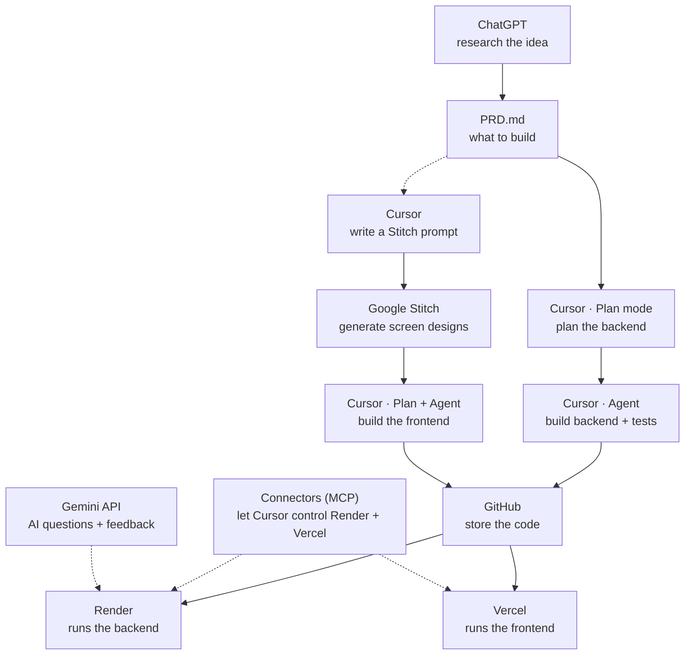
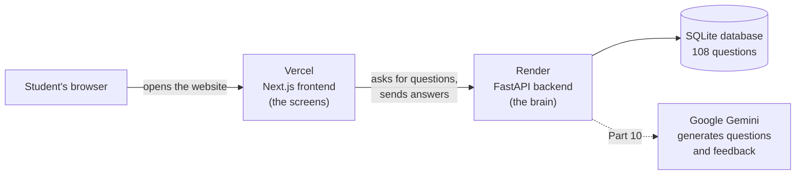
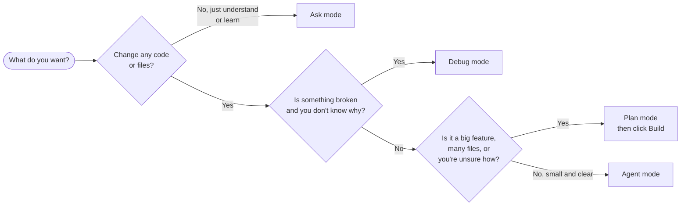
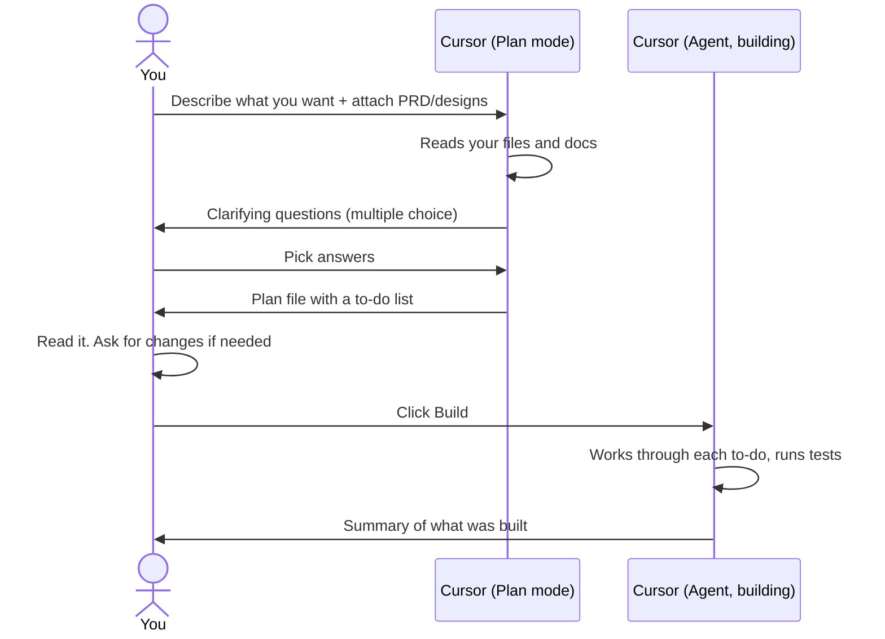
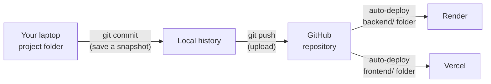
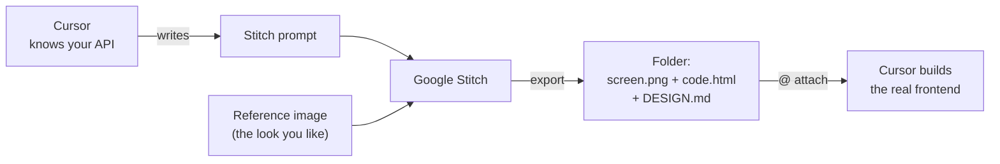
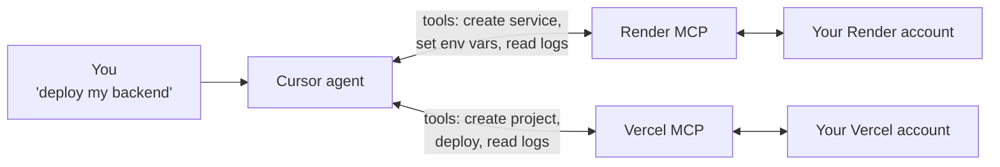
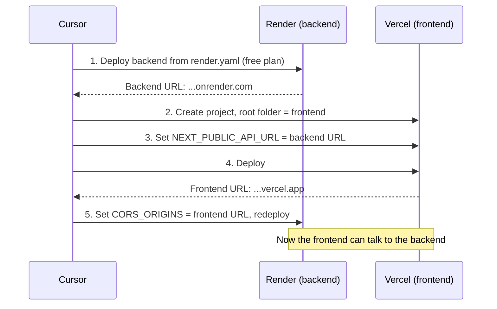

# Diagram sources (Mermaid)

The guide embeds these as pre-rendered SVGs. To change a diagram, edit it here, render it at https://mermaid.live, and replace the matching SVG in index.html.

## The full pipeline

## How the live app works

## Which mode should I use?

## The Plan → Build loop

## How code travels from your laptop to the internet

## Design loop

## What a connector does

## The order of deployment (the chicken-and-egg problem)

(The "Where each setting is stored" diagram is plain HTML in index.html, not Mermaid.)
